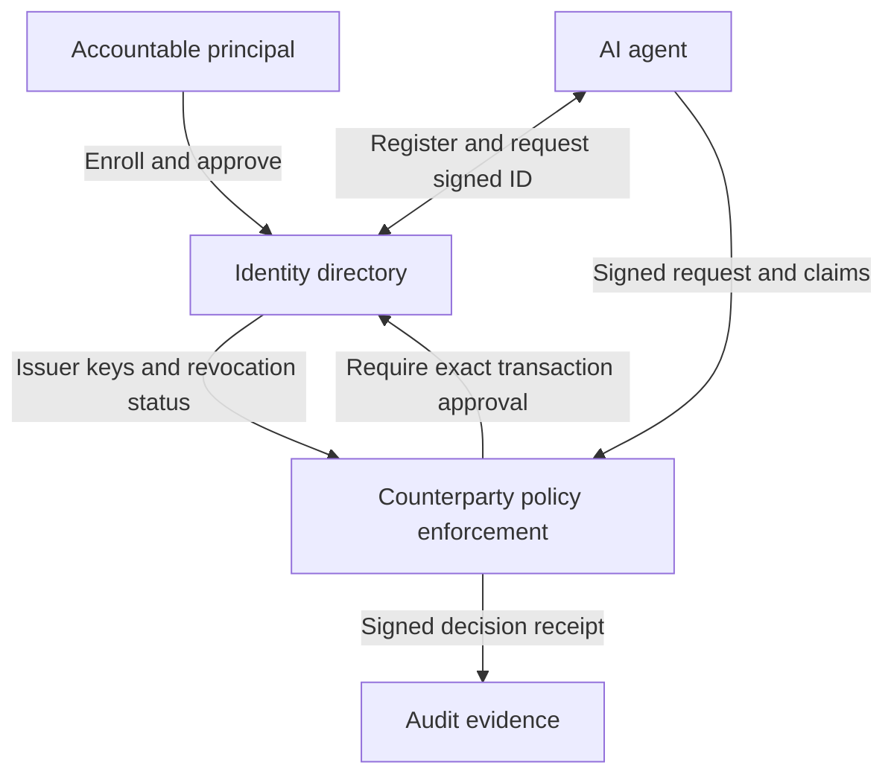

# AI Agent Identity, Authorization and Accountability

This page distinguishes agent identity, delegated authority, transaction approval, runtime enforcement and accountability. Identity is not evidence of safe behavior or permission to execute arbitrary actions.

## Accountable Agents Framework (AAF)

[AAF_OSFI](https://github.com/dazzaji/AAF_OSFI) is an independent Apache-2.0 open-source reference implementation of the Accountable Agents Framework: A Blueprint for AI Agent IDs. As reviewed on 2026-11-26, version 0.2.0 is an experimental pilot, not a formal standard or production-certified solution.

| Component | Demonstrated mechanism |
| --- | --- |
| Principal | Email-control enrollment (low assurance); passkey with user verification for privileged actions |
| Directory | Agent registration, signed IDs and claims, authorization, revocation and identity escrow |
| Agent | Ed25519 key and proof of possession; CLI, skill and local MCP server |
| Counterparty | Validates issuer, audience, expiration, signature, nonce, status and claims; applies access rules |
| Transaction approval | Human passkey approval of an exact fictional order |
| Accountability | Signed decision receipts and simulated authorized tracing to principal |

The pilot issues IDs on demand with five-minute lifetimes and supports per-counterparty identifiers. Its stated revocation bound is 30 seconds (10 seconds publication, 18 seconds accepted age, two seconds clock skew); this is a design claim, not an independent measurement. Revocation stops new issuance and relying parties must enforce status checks.

## Comparative landscape

Status reviewed 2026-11-26. Active Internet-Drafts are work in progress, not approved RFCs; individual drafts are not IETF endorsements. Expired and superseded documents are retained for historical research only.

| Resource | Status | Primary contribution | Applicability and limitations |
| --- | --- | --- | --- |
| [AIMS](https://datatracker.ietf.org/doc/draft-ietf-wimse-aims/) | WIMSE working-group draft -01, active | Workload identity, OAuth delegation, agent mission, transaction tokens | General IAM architecture; work in progress |
| [AI Agent Authentication and Authorization](https://datatracker.ietf.org/doc/draft-klrc-aiagent-auth/) | Replaced/archived -03 | Predecessor to AIMS | Historical only |
| [AgentID](https://datatracker.ietf.org/doc/draft-gudlab-agentid-protocol/) | Expired individual draft -00 | Signed JWT identity, owner and delegation claims | Historical only; not IETF-endorsed |
| [Agent Authorization Profile for OAuth 2.0](https://datatracker.ietf.org/doc/draft-aap-oauth-profile/) | Expired individual draft -01 | Contextual authorization, token exchange and proof of possession | Historical only; distinct from OpenA2A AAP |
| [OpenA2A AAP](https://datatracker.ietf.org/doc/draft-fane-opena2a-aap/) | Active individual draft -02 | Scoped grants, delegation, revocation and credential confinement | Experimental interoperability; not an RFC |
| [AI Agent Authorization Integration Framework](https://datatracker.ietf.org/doc/draft-liu-ai-agent-authorization-integration/) | Active individual draft -00 | OAuth integration, consent evidence and multi-hop delegation | Cross-domain authorization; not an RFC |
| [OpenID Identity Management for Agentic AI](https://openid.net/new-whitepaper-tackles-ai-agent-identity-challenges/) | 2025 community white paper | Interoperable identity profiles and gap analysis | Architecture guidance; not a normative specification |
| [OWASP Agent Control Standard](https://owaspacs.org/docs/identity/overview/) | Community project | Action-level enforcement and agent identity controls | Runtime controls; review evolving conformance requirements |
| [Cisco Agentic Identity Framework](https://www.cisco.com/c/dam/en/us/products/collateral/security/ai/agentic-identity-framework_white_paper.pdf) | 2026 vendor white paper | Enterprise identity lifecycle, scoped access and accountability | Architecture guidance; not a standard |
| [SPIFFE/SPIRE](https://spiffe.io/docs/latest/spiffe-about/overview/) | Open workload identity specifications and implementation | Attested workload identity, short-lived X.509/JWT SVIDs | Infrastructure identity; does not itself express human intent |
| [Agent Payments Protocol (AP2)](https://github.com/google-agentic-commerce/AP2) | Open payment protocol; donated to FIDO Alliance in 2026 | Signed mandates for constrained agent payments | Transaction-specific authorization; not general IAM |
| [AAF additional implementation](https://github.com/christortheak/accountable-agents-framework) | Referenced by AAF_OSFI; independent content verification unavailable | Related implementation of the same framework | Track as related resource; not a distinct framework or validated implementation |

## Layered adoption and control mapping

| Layer | Candidate resources | Required validation |
| --- | --- | --- |
| Workload identity | SPIFFE/SPIRE, AIMS | Attestation, certificate lifecycle, trust-domain isolation |
| Delegated authority | AIMS, OpenA2A AAP, Liu integration draft, PALO | Scope attenuation, consent, audience and delegation chain validation |
| Runtime enforcement | OWASP ACS, CUSTODY | Independent action checks, fail-safe behavior, tool isolation and negative tests |
| Transaction intent | AP2, AAF | Mandate constraints, exact action binding, replay resistance and approval evidence |
| Governance and accountability | AAF, OpenID and Cisco guidance | Principal binding, dual attribution, revocation, privacy and protected audit evidence |

No single resource covers all layers. Evaluate interoperability and failure modes independently; do not infer compliance or production readiness from publication status.

## Reference architecture

## Security and assurance requirements

| Risk | Recommended control and evidence |
| --- | --- |
| Impersonation or credential theft | Distinct keys, proof of possession, protected key storage, rotation and compromise recovery tests |
| Excessive authority or confused deputy | Audience and action-bound authorization, least privilege, independent policy enforcement and negative tests |
| Replay or transaction tampering | Nonces, expiry, signed request binding and exact transaction approval; replay and modification tests |
| Revoked or stale authorization | Fail-closed status validation and measured revocation propagation |
| Repudiation and attribution errors | Signed decision receipts, protected logs and independently validated principal binding |
| Privacy and issuer compromise | Minimize linkability and retention; segregate escrow access, audit disclosure and protect issuer keys |
| Agent escape or prompt injection | Independent runtime containment and tool policy; identity alone cannot prevent malicious authorized actions |

## Limitations and maturity

The pilot uses low-assurance email proofing and one online signing key. It does not implement delegation, key rotation, multi-party escrow or legal-person proofing. The directory observes counterparty and issuance metadata. Lawful identity release is simulated. Hosted testing is invitation-only and orders are fictional. Production use requires independent security review, stronger identity proofing, recovery and key lifecycle management, privacy/legal assessment and availability testing. No independent validation is claimed here.

## Relationship to existing guidance

Use alongside [NIST agent identity guidance](../Frameworks/AI-Agent-Security.md#nist-agent-identity-guidance), [PALO](../Frameworks/PALO-Framework.md) for delegated authority, [CUSTODY](../Frameworks/CUSTODY-Autonomous-Agent-Containment-Framework.md) for containment, and [AI Governance and Assurance](../Frameworks/AI-Governance-and-Assurance.md) for accountability evidence. These are complementary controls, not equivalent standards.

## References

dazzaji. (2026). *Accountable Agents Framework reference implementation* [Computer software]. GitHub. https://github.com/dazzaji/AAF_OSFI

dazzaji. (2026). *Protocol* [Technical documentation]. GitHub. https://github.com/dazzaji/AAF_OSFI/blob/main/docs/PROTOCOL.md

dazzaji. (2026). *Conformance notes* [Technical documentation]. GitHub. https://github.com/dazzaji/AAF_OSFI/blob/main/docs/CONFORMANCE.md

Kasselman, P., Lombardo, J., Rosomakho, Y., Campbell, B., Steele, N., & Parecki, A. (2026, November 2). *AI identity management system* (draft-ietf-wimse-aims-01) [Internet-Draft, work in progress]. https://datatracker.ietf.org/doc/draft-ietf-wimse-aims/

Uzua, T. (2026, March 15). *AgentID: An identity protocol for autonomous AI agents* [Expired Internet-Draft]. https://datatracker.ietf.org/doc/draft-gudlab-agentid-protocol/

Cruz, A. (2026, February 7). *Agent authorization profile (AAP) for OAuth 2.0* [Expired Internet-Draft]. https://datatracker.ietf.org/doc/draft-aap-oauth-profile/

Fane, A. (2026, September 30). *OpenA2A agent authorization protocol (AAP)* [Internet-Draft, work in progress]. https://datatracker.ietf.org/doc/draft-fane-opena2a-aap/

Liu, D., Zhu, H., Krishnan, S., Parecki, A., & Xue, H. (2026, July 6). *AI agent authorization integration framework* [Internet-Draft, work in progress]. https://datatracker.ietf.org/doc/draft-liu-ai-agent-authorization-integration/

OpenID Foundation. (2025). *Identity management for agentic AI*. https://openid.net/new-whitepaper-tackles-ai-agent-identity-challenges/

OWASP GenAI Security Project. (n.d.). *Agent Control Standard: Identity for agents*. https://owaspacs.org/docs/identity/overview/

Cisco. (2026). *Agentic identity framework* [White paper]. https://www.cisco.com/c/dam/en/us/products/collateral/security/ai/agentic-identity-framework_white_paper.pdf

SPIFFE. (n.d.). *SPIFFE overview*. https://spiffe.io/docs/latest/spiffe-about/overview/

Google Agentic Commerce. (n.d.). *Agent Payments Protocol (AP2)*. GitHub. https://github.com/google-agentic-commerce/AP2
