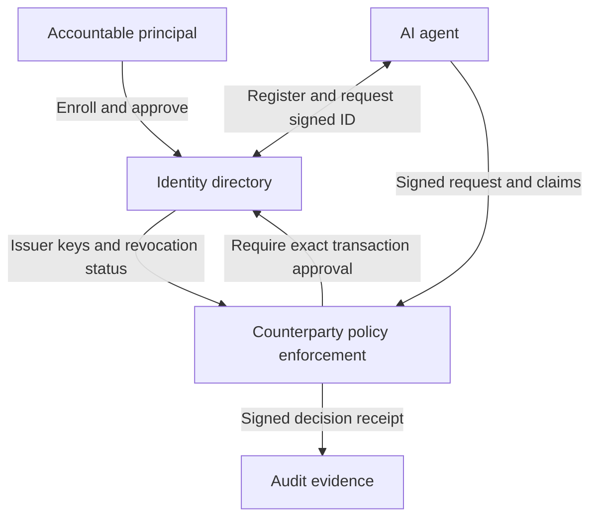

# AI Agent Identity, Authorization and Accountability

This page distinguishes agent identity, delegated authority, transaction approval, runtime enforcement and accountability. Identity is not evidence of safe behavior or permission to execute arbitrary actions.

## Accountable Agents Framework (AAF)

[AAF_OSFI](https://github.com/dazzaji/AAF_OSFI) is an independent Apache-2.0 open-source reference implementation of the Accountable Agents Framework: A Blueprint for AI Agent IDs. As reviewed on 2026-11-26, version 0.2.0 is an experimental pilot, not a formal standard or production-certified solution.

| Component | Demonstrated mechanism |
| --- | --- |
| Principal | Email-control enrollment (low assurance); passkey with user verification for privileged actions |
| Directory | Agent registration, signed IDs and claims, authorization, revocation and identity escrow |
| Agent | Ed25519 key and proof of possession; CLI, skill and local MCP server |
| Counterparty | Validates issuer, audience, expiration, signature, nonce, status and claims; applies access rules |
| Transaction approval | Human passkey approval of an exact fictional order |
| Accountability | Signed decision receipts and simulated authorized tracing to principal |

The pilot issues IDs on demand with five-minute lifetimes and supports per-counterparty identifiers. Its stated revocation bound is 30 seconds (10 seconds publication, 18 seconds accepted age, two seconds clock skew); this is a design claim, not an independent measurement. Revocation stops new issuance and relying parties must enforce status checks.

## Reference architecture

## Security and assurance requirements

| Risk | Recommended control and evidence |
| --- | --- |
| Impersonation or credential theft | Distinct keys, proof of possession, protected key storage, rotation and compromise recovery tests |
| Excessive authority or confused deputy | Audience and action-bound authorization, least privilege, independent policy enforcement and negative tests |
| Replay or transaction tampering | Nonces, expiry, signed request binding and exact transaction approval; replay and modification tests |
| Revoked or stale authorization | Fail-closed status validation and measured revocation propagation |
| Repudiation and attribution errors | Signed decision receipts, protected logs and independently validated principal binding |
| Privacy and issuer compromise | Minimize linkability and retention; segregate escrow access, audit disclosure and protect issuer keys |
| Agent escape or prompt injection | Independent runtime containment and tool policy; identity alone cannot prevent malicious authorized actions |

## Limitations and maturity

The pilot uses low-assurance email proofing and one online signing key. It does not implement delegation, key rotation, multi-party escrow or legal-person proofing. The directory observes counterparty and issuance metadata. Lawful identity release is simulated. Hosted testing is invitation-only and orders are fictional. Production use requires independent security review, stronger identity proofing, recovery and key lifecycle management, privacy/legal assessment and availability testing. No independent validation is claimed here.

## Relationship to existing guidance

Use alongside [NIST agent identity guidance](../Frameworks/AI-Agent-Security.md#nist-agent-identity-guidance), [PALO](../Frameworks/PALO-Framework.md) for delegated authority, [CUSTODY](../Frameworks/CUSTODY-Autonomous-Agent-Containment-Framework.md) for containment, and [AI Governance and Assurance](../Frameworks/AI-Governance-and-Assurance.md) for accountability evidence. These are complementary controls, not equivalent standards.

## References

dazzaji. (2026). *Accountable Agents Framework reference implementation* [Computer software]. GitHub. https://github.com/dazzaji/AAF_OSFI

dazzaji. (2026). *Protocol* [Technical documentation]. GitHub. https://github.com/dazzaji/AAF_OSFI/blob/main/docs/PROTOCOL.md

dazzaji. (2026). *Conformance notes* [Technical documentation]. GitHub. https://github.com/dazzaji/AAF_OSFI/blob/main/docs/CONFORMANCE.md
